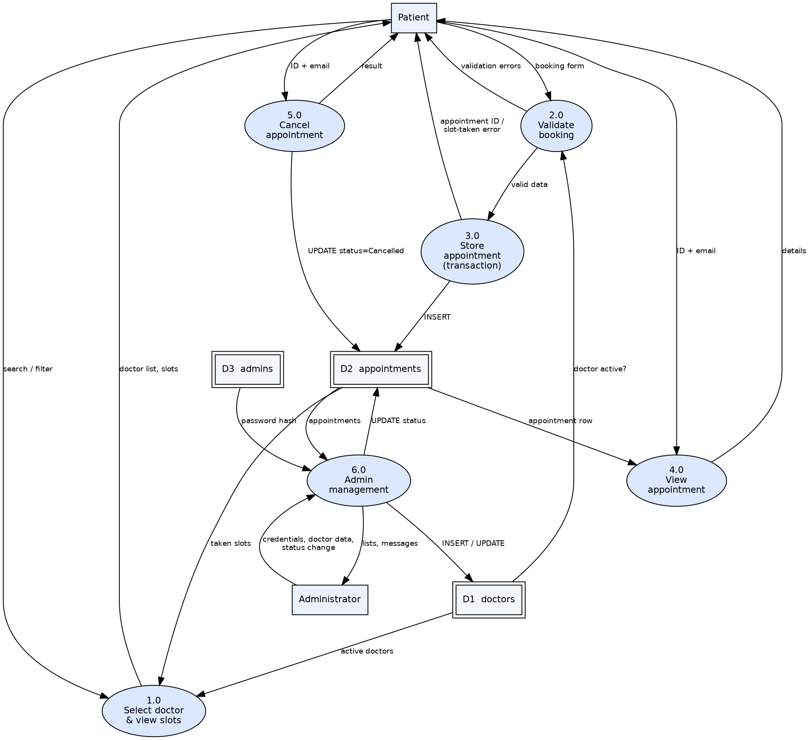

# Data Flow Diagrams

Sources: `docs/diagrams/dfd0.dot`, `docs/diagrams/dfd1.dot` (Graphviz). PNG/SVG exports are in the same folder.

## Level 0

## Level 1

Regenerate images after editing: `dot -Tpng -Gdpi=150 dfd1.dot -o dfd1.png`
