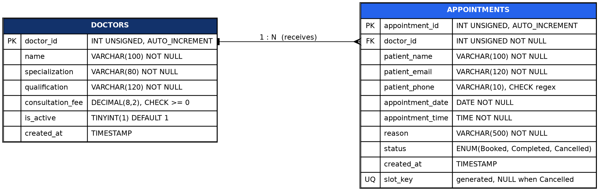
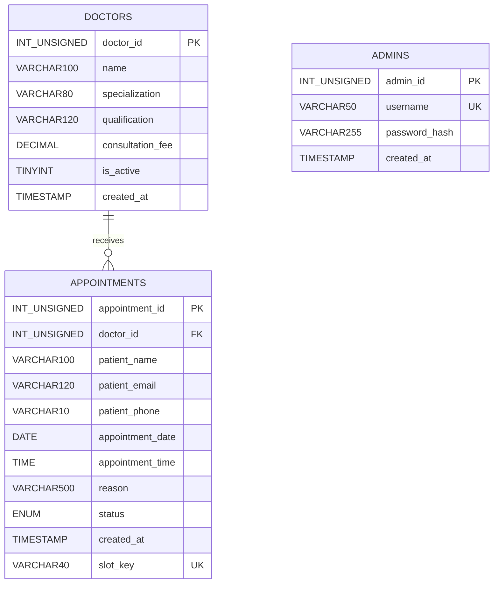

# ER Diagram

Image: `docs/diagrams/er.png` (generated from `docs/diagrams/er.dot` with Graphviz).

Editable Mermaid source (renders automatically on GitHub). It matches `database/schema.sql`.

**Relationship:** one doctor can have many appointments (1:N); every appointment belongs to exactly one doctor.
`ADMINS` is a standalone table used only for administrator login and has no relationship to the other tables.
